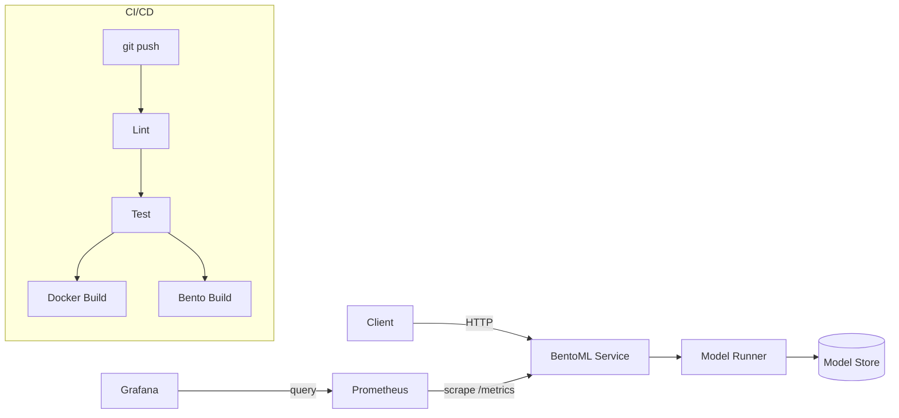

# inference-pipeline-template

Production-ready [Cookiecutter](https://github.com/cookiecutter/cookiecutter) template for ML inference services built on [BentoML](https://github.com/bentoml/BentoML). Generates a containerized API with health checks, structured logging, Prometheus-compatible metrics, and CI/CD — ready for deployment.

## Architecture



## Features

- **BentoML service** with `/health`, `/ready`, `/predict`, `/metrics`, `/version` endpoints
- **Multi-stage Dockerfile** — slim runtime image, non-root user, health check
- **docker-compose** with optional Prometheus and Grafana services
- **GitHub Actions CI** — lint (ruff), test (pytest), Docker build, BentoML build
- **Prometheus-compatible metrics** — request latency histogram, prediction count, error count
- **Grafana dashboard** — pre-built JSON for latency, throughput, and error rate panels
- **Structured JSON logging** for production observability
- Supports **PyTorch** and **TensorFlow** model frameworks

## Quickstart

### Generate a project

```bash
pip install cookiecutter
cookiecutter https://github.com/IbLahlou/inference-pipeline-template
```

You will be prompted for:

| Variable              | Default        | Description                      |
|-----------------------|----------------|----------------------------------|
| `project_slug`        | `bentoml_app`  | Project directory name           |
| `model_framework`     | `pytorch`      | `pytorch` or `tensorflow`        |
| `model_name`          | `model`        | BentoML model store name         |
| `model_service_name`  | `model_svc`    | Service module name              |
| `api_port`            | `3000`         | API port                         |
| `prometheus_port`     | `9090`         | Prometheus port                  |
| `grafana_port`        | `3001`         | Grafana port                     |

### Run locally

```bash
cd <project_slug>
pip install -r requirements.txt

# Save placeholder model
python models.py

# Start the service
bentoml serve model_svc:svc
```

### Run with Docker

```bash
cd <project_slug>

# API only
docker compose up --build

# API + Prometheus + Grafana
docker compose --profile monitoring up --build
```

### Test the API

```bash
# Health check
curl -X POST http://localhost:3000/health

# Prediction
curl -X POST http://localhost:3000/predict \
  -H "Content-Type: application/json" \
  -d '[[1.0, 2.0, 3.0, 4.0]]'

# Metrics (Prometheus format)
curl -X POST http://localhost:3000/metrics

# Version
curl -X POST http://localhost:3000/version
```

## Generated project structure

```
<project_slug>/
├── .github/workflows/ci.yml    # Lint, test, Docker build, Bento build
├── monitoring/
│   ├── prometheus.yml           # Scrape config
│   └── grafana-dashboard.json   # Pre-built dashboard
├── tests/
│   ├── test_metrics.py          # Metrics unit tests
│   └── test_utils.py            # Utility tests
├── model_svc.py                 # BentoML service with endpoints
├── models.py                    # Model save script
├── metrics.py                   # Prometheus-compatible metrics
├── utils.py                     # Shared utilities
├── bentofile.yml                # BentoML build config
├── Dockerfile                   # Multi-stage production image
├── docker-compose.yml           # API + monitoring stack
├── requirements.txt
├── .env.example
└── README.md
```

## CI/CD

The generated GitHub Actions workflow runs on every push and PR to `main`:

1. **Lint** — `ruff check .`
2. **Test** — `pytest tests/ -v`
3. **Docker build** — verifies the image builds cleanly
4. **Bento build** — saves the model and builds the BentoML artifact

Container registry push is not configured by default. Add your registry credentials as GitHub secrets and extend the workflow to push images.

## Production deployment

The generated project is ready for deployment via:

- **Docker** — `docker compose up` on any host
- **BentoCloud / Yatai** — `bentoml push` to deploy managed BentoML services
- **Kubernetes** — build the Docker image and deploy with a Helm chart or manifest

## Roadmap

- Kubernetes Helm chart for production deployment
- Model registry integration with promotion workflow
- Data/model drift monitoring hooks
- A/B testing and canary deployment support
- Feature store integration
- Load testing with Locust
